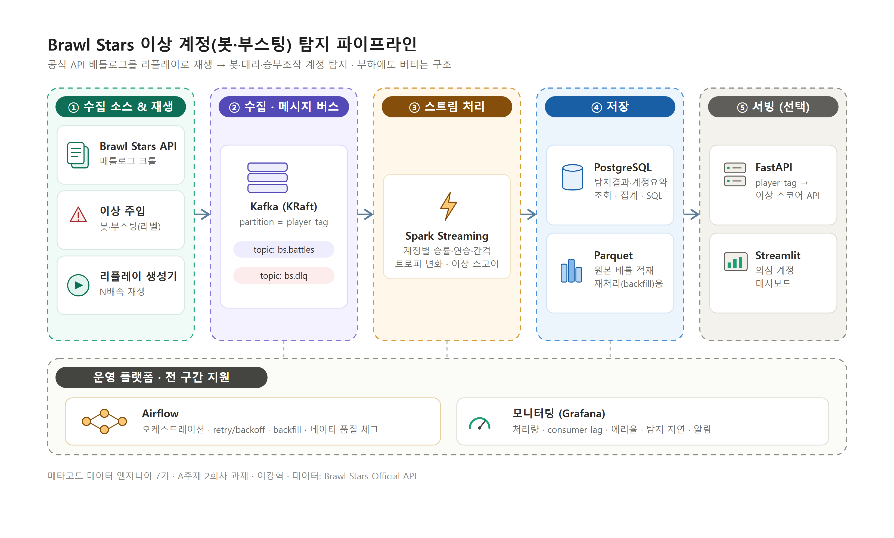

# Brawl Stars 이상 계정(봇·부스팅) 탐지 파이프라인

> 초안임. `TODO` 표시는 직접 돌려보며 확정할 값(샘플 크기·재생 속도 등).

## 한 줄 요약

브롤스타즈 공식 API로 실제 배틀로그를 모아 스트림처럼 재생하고, 봇·대리(트로피 부스팅)·승부조작 같은 이상 계정을 탐지하는 파이프라인.
탐지만이 목적이 아니라, 트래픽을 올려도 유실·중복 없이 버티는 구조가 진짜 목표임.

- 데이터 — 브롤스타즈 배틀로그(실데이터) + 가짜 이상 계정 소량 주입(정답 라벨).
- 문제 — "이 계정, 봇·대리·조작 아닌가?" 판단.
- 사용자 — 게임 운영/안티치트 담당자. 대시보드에서 "지금 의심 계정" 확인.

## 1. 사용 데이터

### 출처

브롤스타즈 공식 API 사용 (`developer.brawlstars.com`에서 무료 토큰 발급, `https://api.brawlstars.com/v1`).
핵심은 배틀로그 엔드포인트. 플레이어 태그당 최근 25전 반환. 한 판마다 시각·모드·맵·승패·트로피 변화·브롤러·팀 구성 포함.

- `GET /rankings/{country}/players` — 상위 랭커 태그 (수집 시작점)
- `GET /players/{tag}/battlelog` — 최근 배틀 기록
- `GET /players/{tag}` — 프로필(트로피·레벨)

수집 방식 — 랭킹에서 시작 태그 확보 → 각 태그 배틀로그 수집 → 배틀에 나온 상대 태그로 확장(크롤).

API에 rate limit 있음. 실시간으로 계속 당기면 부하 테스트 불가. 
따라서 배틀로그를 한 번 모아 JSON으로 저장 → 리플레이 생성기가 battleTime 순서로 배속 재생해 Kafka로 전송. 실데이터를 쓰되 속도는 직접 조절함.

### 이벤트 단위·스키마

이벤트 = 한 배틀 (로그 주인 계정 관점). 수 단위 스트림이 아니라 배틀 요약 단위라 다소 굵음. 대신 봇·부스팅은 배틀 패턴에서 더 잘 드러남.

```jsonc
// topic: bs.battles  (한 배틀 = 한 이벤트)
{
  "event_id":        "20260115T120000Z_#ABC",  // battleTime + player_tag, 중복 제거 기준
  "battle_id":       "a1b2c3",                  // battleTime + 참가자 태그 해시
  "player_tag":      "#ABC",
  "ts":              "2026-01-15T12:00:00Z",    // battleTime, 지연·순서 기준
  "mode":            "gemGrab",
  "map":             "Hard Rock Mine",
  "type":            "ranked",
  "result":          "victory",                 // victory / defeat / draw
  "duration_s":      117,
  "trophy_change":   8,                          // 이 판의 트로피 증감
  "is_star_player":  true,
  "brawler_id":      16000000,
  "brawler_name":    "SHELLY",
  "brawler_power":   11,
  "brawler_trophies":760,
  "opponents":       ["#DEF", "#GHI", "#JKL"],   // 승부조작 탐지용
  "is_injected":     0                           // 가짜 이상 계정이면 1
}
```

- ID — `event_id` 있음 (중복 제거·멱등 저장 기준)
- 발생 시각 — `ts`(battleTime) 있음 (지연 측정·윈도우 집계 기준)

### 규모 (숫자 두 개 → 용량)

- 건당 크기 ≈ 0.6 KB (opponents 배열 포함 JSON 기준)
- 수집 규모 — 플레이어 5,000명 × 25전 ≈ 12.5만 배틀 ≈ 약 75 MB (JSON) / Parquet 압축 시 ≈ 15 MB  *(TODO: 실제 수집 후 확정)*
- 매일 수집 지속 시 ≈ 75 MB/일 → 7일 보관 ≈ 약 525 MB (JSON) / Parquet ≈ 100 MB 내외
- 재생 속도 — 평상 TODO 300/s, 부하 테스트 TODO 3,000 → 30,000/s
- 부하 재생 대역폭 ≈ 30,000/s × 0.6 KB ≈ 18 MB/s (저장이 아니라 Kafka 통과량)

→ 저장 부담은 작음(수십~수백 MB). 관건은 저장 용량이 아니라 **부하 시 처리 대역폭**. 실시간 생성이 아니라 리플레이 기반이라 이렇게 해석함.

### 이상 정의 — 무엇을 "이상"으로 보나

- 봇/매크로 — 플레이 간격이 비정상적으로 규칙적, 같은 모드·같은 브롤러만 반복
- 트로피 부스팅(대리) — 짧은 기간 트로피 급등 + 승률 비정상
- 승부 조작(win-trading) — 특정 상대와 반복 대전하며 번갈아 승패, 트로피 교환
- 신규 계정 어뷰징 — 새 계정인데 고트로피 상대와만 매칭

공개 데이터에 "봇" 라벨 없음. 따라서 가짜 이상 계정 배틀을 소량 주입(`is_injected=1`)해 정답 확보 → 탐지 정확도(precision/recall) 평가 가능하게 만듦.

## 2. 전체 구조도



흐름 — 브롤스타즈 API에서 배틀로그 수집 + 가짜 이상 계정 혼합 → 리플레이 생성기로 재생(①) → Kafka 수신(②) → Spark가 계정별로 승률·연승·플레이 간격·트로피 변화 집계 후 이상 스코어 산정(③) → 결과는 PostgreSQL, 원본은 Parquet 저장(④) → FastAPI·Streamlit으로 노출(⑤). 전 구간을 Airflow가 오케스트레이션, Grafana로 모니터링.

- 수집→Kafka — JSON 이벤트, 배속 재생, `key=player_tag`
- Kafka→Spark — micro-batch(trigger 1분), 계정별 집계
- Spark→PG — 탐지 결과 upsert(player_tag 기준)
- Spark→Parquet — 원본 append, 날짜(dt=) 파티셔닝, 재처리용
- 전 구간→Grafana — 처리량·consumer lag·에러율·탐지 지연 관측 + 임계 초과 시 알림

## 3. 플랫폼 선정 이유 (ADR: 맥락·결정·대안·트레이드오프)

### Kafka
- 맥락 — 배틀 이벤트를 계정별 순서로 유지하며, 실시간 탐지와 원본 적재가 같은 스트림을 각자 소비해야 함. 부하 시 생산/소비 속도차 완충 필요.
- 결정 — Kafka (topic `bs.battles`, partition=`player_tag`, retention 7일).
- 대안 — 파일로 쌓아 배치 처리.
- 트레이드오프 — 운영 컴포넌트가 하나 늘고 로컬 리소스 사용 증가. 단순 파일보다 구조가 복잡해짐.

### Spark
- 맥락 — 이벤트 수십만~수백만 + 스트리밍 + 계정별 윈도우 집계 필요. 데이터 확장 대비.
- 결정 — Spark Structured Streaming.
- 대안 — Pandas 배치 처리.
- 트레이드오프 — 러닝커브·메모리 부담. 데이터가 적으면 오히려 Pandas가 더 간단·빠름.

### Airflow
- 맥락 — 수집(크롤) → 적재 → 일배치 집계 → 품질 체크가 의존 관계. 재시도·backfill·실행 상태 UI 필요.
- 결정 — Airflow (`@daily` DAG, retry + exponential backoff).
- 대안 — cron.
- 트레이드오프 — 셋업이 무겁고 메타DB 필요. 단순 반복이면 cron이 더 가벼움.

### 저장소 이중화 (PostgreSQL + Parquet)
- 맥락 — 탐지 결과는 자주 조회(대시보드·API), 원본은 대량 보관 + 재처리(backfill) 필요.
- 결정 — 결과는 PostgreSQL, 원본은 Parquet.
- 대안 — 한쪽만 사용.
- 트레이드오프 — 저장 로직 두 벌 관리. 결과·원본 간 일관성 신경 써야 함.

### 모니터링 (Grafana)
- 맥락 — 부하 시 처리량·consumer lag·에러율·탐지 지연을 한눈에 보고, 기준 초과 시 알림 필요(로드 테스트 핵심 지표).
- 결정 — Grafana 대시보드 + 알림. 데이터 소스는 PostgreSQL(탐지·집계 지표) + Prometheus(Kafka/Spark 시스템 지표).
- 대안 — 로그만 보기, 또는 Streamlit에 모니터링까지 몰기.
- 트레이드오프 — 모니터링 컴포넌트가 하나 늘어남. 다만 시스템 관측은 Grafana가 표준이라, 결과 조회(Streamlit)와 시스템 모니터링(Grafana)을 분리하는 게 깔끔함.

## 4. 레포 구조 (최종 산출물까지)

```
brawlstars-anomaly-pipeline/
├─ fetch_battlelogs.py  # 브롤스타즈 API 크롤 → 배틀로그 JSON 저장
├─ producer.py   # 배틀로그를 battle 이벤트로 재생해 Kafka로, 속도 조절
├─ anomaly_injector.py  # 가짜 이상 계정(봇·부스팅) 배틀 주입 (라벨)
├─ consumer.py          # Kafka 수신 → 원본 Parquet 적재
├─ preprocess.py        # Spark 전처리·계정별 집계·이상 스코어
├─ dag.py               # Airflow DAG (수집~집계·품질체크)
├─ schema.sql           # PostgreSQL 저장 스키마
├─ create_topics.sh     # Kafka 토픽(bs.battles·bs.dlq) 생성
├─ make_sample.py       # 토큰 없이 테스트용 가짜 배틀로그 생성
├─ docker-compose.yml   # Kafka(KRaft)·Spark·Airflow·PostgreSQL·Grafana
├─ api/                 # (선택) FastAPI 서빙 + Streamlit 대시보드
└─ README.md
```

## 5. Kafka 수집

### Producer 흐름

```
읽기(배틀로그 JSON) → 공통 껍데기로 감싸 직렬화(JSON bytes) → 전송(send) → 콜백으로 성공/실패 확인
```

`producer.py`가 담당. 안정성 설정은 `acks=all`(모든 복제본 확인), `enable_idempotence=true`(재시도해도 중복 저장 안 됨), `compression.type=lz4`(압축). 전송 결과는 **콜백**으로 확인해 실패를 놓치지 않음.

### 메시지 예시 (공통 껍데기 + payload)

```jsonc
key = "#ABC"                       // player_tag → 같은 계정 순서 보장
{
  "event_id":       "20260115T120000Z_#ABC",  // 중복 제거·멱등 저장 기준
  "event_type":     "battle",                  // 이벤트 종류
  "event_time":     "2026-01-15T12:00:00Z",    // 발생 시각
  "schema_version": 1,                         // 필드 바뀌어도 consumer 안 깨짐
  "source":         "replay-generator",        // 출처
  "payload": {                                 // 종류별 실제 데이터
    "battle_id": "a1b2c3", "player_tag": "#ABC",
    "mode": "gemGrab", "result": "victory", "trophy_change": 8,
    "brawler_name": "SHELLY",
    "teammates": ["#DEF"],                     // 같은 팀(나 제외) → 팀 어뷰징 탐지
    "opponents": ["#GHI", "#JKL"],             // 상대 팀만 → 승부조작 탐지
    "is_injected": 0
  }
}
```

> **팀원/상대 분리**: 기존엔 `opponents`를 "나를 뺀 전원"으로 잡아서 **팀원이 상대에 섞였음**. 배틀 데이터의 `teams`(팀 2개 리스트)에서 **내가 속한 팀 → `teammates`, 나머지 팀 → `opponents`**로 분리하도록 수정함. 이렇게 해야 **승부조작**(상대 반복)과 **팀 어뷰징/듀오 부스팅**(팀원 반복)을 각각 정확히 탐지할 수 있음.

### Topic 구성

| 항목 | 값 | 이유 |
|---|---|---|
| 토픽명 | `bs.battles` | 배틀 이벤트 전용 (실패 메시지는 `bs.dlq`로 분리) |
| 파티션 | 3 | 병렬 처리 상한. 로컬 3개로 시작 → 늘려가며 처리량 측정 |
| key | `player_tag` | 같은 계정 이벤트의 순서 보장 (승률·연승 계산에 필요) |
| 리텐션 | 7일 | 재처리 가능 기간. 앞의 용량 계산과 함께 결정 |

### 실행

```bash
docker compose up -d kafka            # Kafka 기동
bash create_topics.sh                 # 토픽 생성
python producer.py --in data/raw --rate 300   # 전송 (초당 300건)
```

## 6. 트러블슈팅 기록 (수집 구현 중 겪은 이슈)

에러 메시지(근거)로 원인을 좁혀 해결한 기록. 모두 실제로 겪은 사례.

| 증상 | 확인한 근거 | 원인 | 해결 / 다음 행동 |
|---|---|---|---|
| `OCI runtime exec failed: .../Git/opt/kafka/...` | 에러 속 경로가 Git 설치폴더로 바뀜 | Git Bash(MSYS)가 `/opt/...`를 Windows 경로로 자동 변환 | `MSYS_NO_PATHCONV=1` 적용 (create_topics.sh에 내장) |
| 전송/수신 로그 한글 `▒▒▒` | 콘솔 출력만 깨짐(데이터는 정상) | 콘솔 인코딩(cp949) | `PYTHONUTF8=1 python ...` 로 실행 |
| `python producer.py` → `No such file` | 에러 메시지 | 상위 폴더에서 실행(파일은 `projects/...` 하위) | 프로젝트 폴더로 `cd` 후 실행 |
| `docker compose up` → `no configuration file provided` | 에러 메시지 | compose 파일 없는 폴더에서 실행 | 프로젝트 폴더에서 실행 |
| `git push` → `rejected (fetch first)` | push 거부 메시지 | 원격에 먼저 올라간 커밋 존재 | `git fetch` + `git rebase` 후 push |
| `bash` 실행 실패 (`execvpe /bin/bash`) | 에러 메시지 | PowerShell의 `bash`가 미설정 WSL로 연결 | **Git Bash**에서 실행 |
| (API) `403 Forbidden` | 응답 코드 | 토큰 등록 IP와 현재 IP 불일치 | developer 포털에서 현재 IP로 키 재발급 |
| (수집) `ReadTimeout … handshake timed out` → 크롤 전체 중단 | 스택트레이스 + "411명 저장 후 종료" | 네트워크 일시 타임아웃을 재시도 안 해, 1건 실패에 크롤 전체가 죽고 대기 큐(수만 건) 유실 | `_get`에 timeout·연결오류 backoff 재시도, 재시도 소진 시 그 태그만 skip + 재실행 이어받기 (아래 상세) |

> 핵심: 증상이 나오면 **에러 메시지를 근거로 원인을 하나씩 좁혀** 해결함. 환경(Windows/Git Bash) 이슈가 대부분이었고 파이프라인 로직 문제는 아니었음.

### 수집기 내구성 보강 — 실제 장애 → 조치 (`fetch_battlelogs.py`)

- **상황**: `--max-players 2000`으로 대량 수집 중, **411명 저장 시점**에 `requests.exceptions.ReadTimeout`(SSL handshake timed out, `api.brawlstars.com:443`)으로 **크롤 프로세스 전체가 종료**됨. 메모리에 있던 대기 큐(약 5.4만 건)도 함께 유실.
- **원인**: `_get`은 `429/5xx`만 재시도하고 **네트워크 타임아웃·연결 끊김(`Timeout`/`ConnectionError`)은 잡지 않음** → 단 한 번의 일시 장애가 전체 수집을 중단시키는 **단일 실패점**. 게다가 수집은 재개 수단이 없어 재실행하면 처음부터였음.
- **조치**:
  1. **`_get`** — `Timeout`·`ConnectionError`를 잡아 **지수 backoff 재시도**(`2^n`초), 재시도 소진 시 `ApiError`로 올려 **그 태그 하나만 skip**(크롤은 계속). 읽기 타임아웃도 `10s → (connect 5s, read 20s)`로.
  2. **`crawl`** — 출력 파일이 이미 있으면 **API를 다시 호출하지 않고 디스크에서 읽어 큐만 확장** → 중간에 죽어도 **재실행하면 받은 건 건너뛰고 이어서 수집**(멱등 재개). `--max-players`는 "이번 실행에서 신규로 받을 계정 수"로 의미 정리.
- **효과**: 일시 네트워크 장애가 **1건 skip**으로 흡수되고, 수집이 **중단돼도 손실 없이 이어받음** → 수집 구간의 단일 실패점 제거(안정적 파이프라인 목표에 부합).

### 수집기 처리량 개선 — 동시 요청 (`fetch_battlelogs.py`)

- **상황/원인**: 대량 수집이 **초당 1건**밖에 안 됨. `requests`가 **동기·단일 스레드**라 "요청 → 응답 대기 → 다음 요청"을 순차로 하는데, API 왕복(RTT)이 계정당 ~1초 → `--rps`를 올려도 **왕복 대기가 병목**이라 안 빨라짐. 5만 건(2천 계정)은 괜찮지만 50만 건(2만 계정)은 ~5시간.
- **조치**:
  1. **`ThreadPoolExecutor`(기본 workers 12)** — 요청을 동시에 여러 개 날려 **왕복 대기를 겹침**. BFS는 in-flight를 `workers×2`로 유지하는 producer-consumer로 전환(`wait(FIRST_COMPLETED)`).
  2. **스레드 안전 rate limit** — `_get`의 호출 간격 로직을 `Lock`으로 감쌈. sleep은 lock 안에서 '순번'만 맞추고 네트워크 대기는 lock 밖이라 요청끼리 겹침 → **전체 속도는 `--rps`가 상한**(429 예방), 동시성은 처리량만 올림.
  3. 기존 **재개(이어받기)·timeout 재시도**는 worker 안에 그대로.
- **트레이드오프**: 동시성을 너무 올리면 `429 rate limit`/IP 차단 위험 → **`--rps`(전체 상한) + `--workers`(동시성)** 를 분리해 조절. 권장 시작값 `--rps 10 --workers 12`(≈10배). 더 빠르게는 `--rps` 상향(429 뜨면 backoff가 흡수하지만 과하면 낮추기).
- **효과**: `--rps 10` 기준 ~10계정/초 → 5만 건 ≈ 몇 분, 50만 건 ≈ 30분대. `--rps`만 올려 조절.

## 7. 재시작과 멱등성 (멈춰도 안전하게)

### 멱등성 2종 — 구분이 핵심
| 종류 | 무엇을 막나 | 우리 구현 |
|---|---|---|
| **전송 멱등** (`enable_idempotence`) | **재시도** 중 생기는 중복만 | ✅ producer 설정 |
| **저장 멱등** (`event_id` 유일 + upsert) | **프로그램 재실행**으로 생기는 중복 | ✅ event_id 고정 + 저장단계 upsert |

→ 전송 멱등만으로는 **재실행 중복을 못 막음**. 최종 중복 제거는 **저장 멱등(event_id)**이 담당.

### 중간에 멈추면 어떻게 되나
- **수집(fetch)·전송(producer)**: 진행 위치를 기록하지 않음 → **처음부터 전체 재전송**
- 이미 보낸 게 또 와도 `event_id = battleTime + player_tag`가 **재실행해도 동일** → 저장 시 **같은 id면 덮어씀(upsert)** → 중복 제거
- 결과: **유실 없음**(전체 재전송) + **중복은 흡수** → "재처리 + 멱등" 방식
- **소비(consumer/Spark)**: Kafka가 **offset을 기록** → 멈춘 지점부터 자동 재개 (`checkpointLocation`)

### 트레이드오프
재실행 시 전체 재처리라 비효율은 있으나 **소량 리플레이라 무시 가능**. 단순함을 위해 체크포인트(진행위치 기록) 대신 **재처리+멱등**을 택함. 데이터가 커지면 fetch에 진행위치 저장을 추가할 수 있음.

### 커밋 순서 원칙
`처리 → 저장 → (진행위치) commit` 순서. commit을 **먼저** 하면 저장 실패 시 **유실**, **나중에** 하면 중복(멱등으로 해결). 그래서 **commit은 항상 마지막 + 멱등 저장**. (consumer는 `enable_auto_commit=False`)

## 8. 전처리와 저장 — `preprocess.py`

### 처리 흐름

```
Kafka(bs.battles) ──배치 읽기──┬─ 유효 ─▶ 전처리 ──▶ Parquet(정제 원본)
                               │                 └─집계·이상 스코어─▶ PostgreSQL(탐지 결과)
                               └─ 불량 ─▶ Kafka(bs.dlq)   ← 버리지 않고 격리
```

입력은 **Kafka(`bs.battles`)에서 읽는다** — 파일을 직접 읽으면 Kafka를 쓰는 의미가 없으므로, 수집 구간이 넣어둔 Kafka 데이터를 Spark가 소비한다. (Spark의 `read.format("kafka")`로 `earliest~latest` 전체를 **배치**로 읽음)

### 전처리 단계

| 항목 | 처리 | 코드 |
|---|---|---|
| 자료형 | `event_time` 문자열 → timestamp(UTC, **발생 시각**) | `to_timestamp` |
| 결측 | 필수 필드(`event_id`·`player_tag`·`event_time`) 없으면 **불량 분리 → `bs.dlq` 격리** | `filter(~valid)` |
| 중복 | **`event_id` 기준** 중복 제거 (재실행 중복 흡수) | `dropDuplicates(["event_id"])` |
| 집계 | 계정별 승률·트로피 증감·브롤러 다양성 | `groupBy("player_tag")` |

### 입력 · 출력 예시

입력 (Kafka 메시지, 공통 껍데기) — §5 참고.
출력 (계정별 탐지 결과, `detection_result`):

```
[입력] Kafka 메시지 125건  →  [정제] 125건 (중복·결측 제거 후)
player_tag   | battles | win_rate | trophy_gain | brawler_variety | anomaly_score | anomaly_reason
#29C8PULJ9   |   25    |  0.92    |     74      |       6         |     0.8       |   boosting
#2V8V0QCVJP  |   25    |  0.84    |     60      |       1         |     0.6       |   bot
#8LQCUYPYL   |   25    |  0.88    |     58      |       1         |     0.6       |   bot
#QVLRCJQ00   |   25    |  0.84    |     -2      |       5         |     0.1       |   normal
```
(실제 실행 결과. 브롤러 1종류 → bot, 승률 0.9 초과 → boosting, 그 외 normal로 분류됨)

### 전처리 검증 — 일부러 더러운 데이터 주입 (`dirty_injector.py`)

공식 API 데이터는 깨끗해서 평소엔 `입력 = 정제`(125→125)로 걸러지는 게 안 보인다.
전처리가 실제로 동작하는지 확인하려고 **일부러 지저분한 메시지를 Kafka에 넣고** 돌려본다.

주입하는 4가지 유형 (각각 어느 단계가 잡는지):

| 더러운 유형 | 잡는 단계 |
|---|---|
| 깨진 JSON (파싱 불가) | `from_json` 실패 → `event_id` null → `dropna` |
| `player_tag` 결측 | `dropna` |
| `event_time` 이상 문자열 | `to_timestamp` null → `dropna` |
| 중복 `event_id` (n건) | `dropDuplicates` → 1건만 생존 |

```bash
PYTHONUTF8=1 python dirty_injector.py        # 유형별 2건 = 8건 주입
# 그 뒤 preprocess 재실행
```

실제 결과 — **8건 중 7건 제거** (중복 2건 중 정상 1건만 생존):

```
[입력] Kafka 메시지 133건  →  [정제] 126건 (중복·결측 제거 후)
#DIRTYTEST | battles 1 | ... | is_injected 1   ← 중복에서 살아남은 1건
```

→ `입력 > 정제`로 벌어지는 것 자체가 전처리가 더러운 데이터를 걸러낸다는 증거다.

**재주입해도 결과 고정 (= 멱등성 증명, §7 참고).**
같은 주입을 한 번 더 돌리면 입력은 늘지만 정제는 **그대로**다.

```
1회 주입 후:  [입력] 133건 → [정제] 126건
2회 주입 후:  [입력] 141건 → [정제] 126건   ← 입력 +8인데 정제는 그대로
```

- `DUP_DEMO`는 **event_id가 고정**이라 몇 번을 넣어도 `dropDuplicates`가 1건으로 합침 → `#DIRTYTEST` 는 계속 `battles=1`.
- 깨진·결측·이상은 매번 걸러짐.
- **의미**: producer를 실수로 재실행하거나 파이프라인이 죽었다 재시작해 같은 데이터를 또 읽어도 결과가 안 꼬인다. "유실 없고 중복 없는" 안정적 파이프라인의 증거.

(주입한 메시지는 토픽에 남으므로, 초기화하려면 `bs.battles` 토픽을 재생성한다.)

### 불량 격리 (DLQ) — 버리지 말고 `bs.dlq`로

불량 레코드를 `dropna`로 **조용히 버리면** "무엇이 왜 빠졌는지" 알 수 없다(유실·관측성 문제).
그래서 전처리에서 **유효/불량을 나눠**, 불량은 **원본 그대로 `bs.dlq`로 보낸다.**

| 불량 유형 | 격리 사유(`reason`) |
|---|---|
| 깨진 JSON (파싱 실패) | `parse_fail_or_missing_event_id` |
| `player_tag` 결측 | `missing_player_tag` |
| `event_time` 이상 | `bad_event_time` |

DLQ 메시지는 **원본(`original`) + 사유(`reason`) + 격리시각(`dlq_time`)** 을 담는다.

실제 실행 — dirty_injector로 8건 주입 후:
```
[입력] Kafka 메시지 133건  →  [정제] 126건  ·  [DLQ 격리] 6건 (불량은 bs.dlq로)
```
```bash
# bs.dlq 확인
docker compose exec kafka /opt/kafka/bin/kafka-console-consumer.sh \
  --bootstrap-server localhost:9092 --topic bs.dlq --from-beginning
# → {"original":"{\"event_id\":\"broken\"...","reason":"parse_fail_or_missing_event_id",...}
```
→ 깨진 데이터도 **유실 없이 격리**되므로, 나중에 원인을 보고 재처리할 수 있다.
(참고: DLQ 전송은 append라 preprocess를 재실행하면 같은 불량이 또 쌓인다 — 조회·원인분석용이므로 허용.)

### 최종 스키마 — `detection_result` (PostgreSQL)

| 필드 | 타입 | 의미 |
|---|---|---|
| `player_tag` | TEXT (PK) | 계정 (고유 키) |
| `battles` | INT | 집계 대상 배틀 수 |
| `win_rate` | DOUBLE | 승률 (0~1) |
| `trophy_gain` | INT | 누적 트로피 증감 |
| `brawler_variety` | INT | 브롤러 종류 수 (1이면 봇 의심) |
| `anomaly_score` | DOUBLE | 이상 점수 (0~1) |
| `anomaly_reason` | TEXT | bot / boosting / normal |
| `is_injected` | SMALLINT | 평가용 정답 라벨 |
| `updated_at` | TIMESTAMPTZ | 갱신 시각 |

고유 키 = `player_tag`. 정제 이벤트의 중복 판단 기준 = `event_id`(= battleTime+player_tag).

**인덱스** (2개):

| 인덱스 | 컬럼 | 왜 |
|---|---|---|
| PK (자동) | `player_tag` | 계정 조회 + **계정당 1행 보장**(멱등 기준) |
| `idx_detection_score` | `anomaly_score DESC` | **"의심 상위 N개" 조회**(`ORDER BY anomaly_score DESC`) 가속 — preprocess 출력·Grafana 대시보드의 핵심 쿼리 |

> `anomaly_reason`(bot/boosting/normal 3종)은 **카디널리티가 낮아** 인덱스를 걸지 않음. 이 인덱스들은 **스테이징+UPSERT** 저장(Spark가 `detection_result`를 직접 재생성하지 않음) 덕에 매 실행 유지된다(아래 '설계 개선 내역' 참고).

### 저장 포맷과 이유

| 저장소 | 포맷 | 이유 |
|---|---|---|
| PostgreSQL | 테이블 | 탐지 **결과를 빠르게 조회**(대시보드·API). SQL·인덱스·집계 |
| Parquet | 컬럼 기반 파일 | **정제 원본 보관 + 재처리**. 압축·분석 최적화. 날짜(`dt=`) 파티셔닝 |

재실행하면 Kafka 전체를 다시 읽어 결과를 **덮어씀(overwrite)** → 멱등(같은 입력이면 같은 결과).
PostgreSQL 저장은 **스테이징 + UPSERT** 방식이다: Spark는 이번 실행분을 `detection_result_staging`에 쓰고, `upsert_detection.py`가 `detection_result`로 **`INSERT … ON CONFLICT(player_tag) DO UPDATE`** 병합한다. → **이번 배치에 없는 계정은 지워지지 않고 누적**(날짜별 처리에 맞음), schema.sql의 **PK·인덱스도 유지**됨. (이전엔 `option("truncate","true")`로 전체 TRUNCATE+INSERT — 매 실행 전체 교체라 누적 불가였음)

> **실제 겪은 함정 — truncate=true만으론 부족, 테이블이 schema.sql産이어야 함**
> - 증상: 저장은 되는데 `\d detection_result` 에 PK·인덱스가 없음(`pg_indexes` 0 rows). 타입도 `bigint`·`timestamp without time zone` 등 **Spark 추론형**.
> - 진단: 과거 어느 실행에서 Spark가 **`truncate` 없는 overwrite**로 schema.sql 테이블을 DROP·재생성해 PK 없는 테이블로 바꿔놨고, `pgdata` **볼륨이 유지**돼서 schema.sql(init 스크립트, 빈 볼륨 최초 1회만 실행)이 다시 안 돎. `truncate=true`는 *기존 구조를 보존*할 뿐이라 **PK 없는 테이블을 그대로 보존**하고 있었음.
> - 조치: `DROP TABLE detection_result` → `psql -f /docker-entrypoint-initdb.d/schema.sql`로 **PK+인덱스 포함 재생성** → Spark 재실행. 이후 `\d`에 `detection_result_pkey`·`idx_detection_score` 정상 표시.
> - 교훈: 인덱스를 유지하려면 ①테이블은 **schema.sql로 생성**하고 ②Spark는 **항상 truncate=true**여야 둘이 맞물린다. (운영에선 `AUTO_CREATE`/plain overwrite가 스키마를 덮지 않게 주의)

### 실행 (Spark 컨테이너 안에서 — 로컬 Java/pyspark 불필요)

```bash
docker compose up -d kafka postgres spark
bash create_topics.sh
PYTHONUTF8=1 python producer.py --in data/raw --rate 10     # Kafka에 데이터 채우기
docker compose exec spark /opt/spark/bin/spark-submit --master "local[*]" \
  --conf spark.jars.ivy=/tmp/.ivy2 \
  --packages org.apache.spark:spark-sql-kafka-0-10_2.12:3.5.3,org.postgresql:postgresql:42.7.3 \
  /app/preprocess.py
```
(Git Bash에서는 맨 앞에 `MSYS_NO_PATHCONV=1` 붙여 경로 변환 방지. `spark.jars.ivy=/tmp/.ivy2`는 비root 유저 Ivy 캐시 쓰기 권한 이슈 회피.)

> Spark가 **Kafka 컨테이너에 접속하려면** 내부 리스너가 필요해서 docker-compose의 Kafka에 `kafka:29092`(컨테이너용) + `localhost:9092`(호스트용) **2개 리스너**를 설정함. (컨테이너 간 접속 이슈 대응)
> Spark 이미지는 공식 `apache/spark:3.5.3` (bitnami/spark는 Docker Hub에서 내려감).

### 입력 · 출력 위치

| 구분 | 위치 |
|---|---|
| 입력 | Kafka 토픽 `bs.battles` |
| 출력(결과) | PostgreSQL `brawlstars` DB의 `detection_result` 테이블 |
| 출력(정제 원본) | Parquet `data/parquet/battles/` (날짜 `dt=` 파티셔닝) |

### 설계 개선 내역

개선한 지점과 **왜 그렇게 고쳤는지** 기록.

| 개선 지점 | 왜 문제였나 | 어떻게 반영 |
|---|---|---|
| **overwrite가 테이블을 날린다** | Spark `mode("overwrite")`는 테이블을 **DROP 후 재생성** → `schema.sql`의 **PK·인덱스가 매 실행마다 사라짐**(문서와 실제 불일치). Grafana 조회·업서트 기준이 깨짐 | `option("truncate","true")` 추가 → **TRUNCATE+INSERT**로 테이블 정의 **보존**. (단, 출력 컬럼 바뀌면 테이블 수동 ALTER 필요) |
| **불량 데이터가 그냥 사라진다** | 불량(깨진 JSON·결측·이상 시각)을 `dropna`로 **조용히 버리면** 무엇이 왜 빠졌는지 알 수 없음 → **유실·관측성 문제** | **DLQ 라우팅** 추가 → 유효/불량을 나눠, 불량은 **원본+사유로 `bs.dlq`에 격리**. 나중에 원인 분석·재처리 가능 |
| **전체 overwrite라 누적이 안 된다** | `truncate+INSERT`는 매 실행 테이블을 비우고 그 배치만 다시 넣음 → **이번 배치에 없는 계정이 사라져** 날짜별 누적 불가 | **스테이징 + UPSERT**로 전환 → Spark는 `detection_result_staging`에 적재, `upsert_detection.py`가 `ON CONFLICT(player_tag) DO UPDATE` 병합. 전처리 소유 컬럼만 갱신해 `ml_score`·`final_score` 등 **다른 단계 컬럼도 보존**. DAG에 `upsert_detection` 태스크 추가 (2026-11-04) |

> 두 변경 모두 "**유실 없이, 추적 가능하게**"라는 안정적 파이프라인 방향과 일치. 상세는 위 **저장 포맷**·**불량 격리(DLQ)** 절 참고.

### 남은 문제 (한계 · 다음 개선)

- **승부조작 탐지 미구현** — `opponents` 배열을 explode 해서 (player, opponent) 쌍 반복 횟수를 세야 함. 현재는 봇·부스팅만.
- **룰 임계값이 소량 데이터 기준** — 실데이터 5명뿐이라, 더 수집해 precision/recall로 임계값 튜닝 필요.
- ~~**저장이 전체 overwrite(스냅샷)** — 증분/누적이 아님~~ → **해결(2026-11-04)**: 스테이징+UPSERT로 전환, 날짜별 누적 지원 (위 '설계 개선 내역' 참고).
- **쇼다운(솔로) 모드 미처리** — `teams`가 없는 모드는 현재 payload 변환에서 제외됨(`players` 키 분기 TODO).

## 9. 운영 — Airflow DAG — `dag.py`

수동으로 하던 `producer.py` → `spark-submit preprocess.py` 순서를 **Airflow가 매일 자동**으로 묶는다.
(Jenkins처럼 전체 과정을 자동 실행하되, Airflow는 **날짜·멱등·backfill**이 더해진 **데이터 파이프라인** 전용 오케스트레이터)

### DAG 구조
```
resolve_target_date → fetch_battlelogs → produce_to_kafka → spark_preprocess
  → upsert_detection → ml_detect → match_fixing → combine_scores → quality_check
         └──────────── 실패 시 Discord 알림 (on_failure_callback) ───────────┘
```

| Task | 하는 일 | 스크립트 |
|---|---|---|
| `resolve_target_date` | 처리 날짜 결정(`target_date` 지정 시 그 날만, 비우면 전체) | DAG 내 Python |
| `fetch_battlelogs` | Supercell API 수집 → `data/raw` | `fetch_battlelogs.py` |
| `produce_to_kafka` | 리플레이로 Kafka 전송 | `producer.py` |
| `spark_preprocess` | 전처리+집계+Parquet+**스테이징 적재**+DLQ | `spark-submit preprocess.py` |
| `upsert_detection` | 스테이징 → `detection_result` **UPSERT 병합** | `upsert_detection.py` |
| `ml_detect` | IsolationForest 이상도 → `ml_score` | `ml_detect.py` |
| `match_fixing` | 상대 반복 횟수 → `max_opp_repeat` | `match_fixing.py` |
| `combine_scores` | 세 신호 통합 → `final_score`·`flagged_by` | `combine_scores.py` |
| `quality_check` | 건수·null·전수의심 점검 (실패 시 알림) | DAG 내 Python |

### ① retry·backoff 전략 — 어느 걸 재시도, 어느 걸 알림
| Task | retry | 이유 |
|---|---|---|
| fetch / produce / preprocess | **O** (지수 백오프 1→2→4분) | API 429·Kafka 끊김·DB 일시오류 = **일시적 인프라 문제** → 재시도. 모두 멱등이라 안전 |
| quality_check | **X** (`retries=0`) | **데이터가 틀린 것**은 재시도해도 똑같음 → **바로 Discord 알림** |

### ② 스케줄 · 날짜
- `schedule="@daily"`, `catchup=False`
- **리플레이 날짜 매핑**: 데이터 날짜 = 배틀 발생 시각(`event_time`), 실행 날짜 = DAG `logical_date`.
  과거 배틀을 리플레이하므로 **둘은 분리**(특정 날짜 재처리는 `target_date` 파라미터로).

### ③ 멱등성
`preprocess`가 **스테이징 overwrite + event_id 중복제거**, `upsert_detection`이 **`ON CONFLICT(player_tag)` 병합**이라, **같은 날 두 번 실행해도 `detection_result` 결과 동일**.
→ "같은 날짜 2회 실행 → 결과 같음"을 그대로 만족. (DLQ만 append라 중복 — 조회용이므로 허용)

### 실행 요건
Airflow가 프로젝트 스크립트·Kafka·Spark에 접근해야 함:
- 프로젝트 마운트(`./:/opt/project`, `PROJECT_DIR`) + deps(`kafka-python`·`lz4`·`requests`)
- `spark_preprocess`는 Spark 접근 필요 → 운영에선 **`SparkSubmitOperator`** 권장(또는 호스트 standalone 실행)
- `DISCORD_WEBHOOK` 환경변수 설정 시 실패 알림 전송

### 실제 구동 기록 — 로컬에서 end-to-end green

DAG를 "파싱·UI"만이 아니라 **실제로 끝까지 실행**해본 기록.

**배선 (`Dockerfile.airflow` + docker-compose):** airflow 컨테이너가 파이프라인을 돌리려면 —
- 프로젝트 마운트 `./:/opt/project` (fetch/produce가 스크립트·`data/raw` 접근)
- `docker.sock` 마운트 → `spark_preprocess`가 **이미 떠 있는 spark 컨테이너를 `docker exec`** 로 호출
- 커스텀 이미지(`Dockerfile.airflow`)에 **docker CLI + python deps**(kafka-python·lz4·requests)
- producer는 컨테이너 내부 실행이라 **`--bootstrap kafka:29092`** (localhost 아님)

**실행:** `docker compose build airflow` → `up -d airflow` → `airflow dags unpause/trigger`.
UI 로그인 비번을 잃으면(이미지 재빌드 시 파일 사라지나 메타DB의 유저는 유지) `airflow users create` 로 새 admin 생성.

**결과:** `fetch → produce → spark_preprocess → quality_check` **전부 success** (end-to-end green).

**겪은 문제 — Parquet `_temporary` FileNotFound (OneDrive/Windows 마운트):**
- 증상: `spark_preprocess`가 간헐 실패 — `java.io.FileNotFoundException: .../parquet/battles/_temporary/0/.../dt=… does not exist`
- 원인: 프로젝트가 **OneDrive 동기화 폴더**라, Spark가 `_temporary`에 쓰고 최종 경로로 rename하는 사이 **OneDrive/Windows 마운트가 파일을 건드려** 목록 조회가 불안정. (직접 실행 땐 되다 안 되다 하던 이유)
- 조치: SparkSession에 **`spark.hadoop.mapreduce.fileoutputcommitter.algorithm.version=2`** — 태스크 출력을 **최종 경로에 바로 커밋**해 `_temporary` rename/merge를 최소화.
- 부수 확인: 조치 전에도 **retry(지수 백오프)가 일시 실패를 흡수**해 다음 시도에서 성공 → "인프라성 일시 실패는 재시도로 복구"라는 §9① 설계가 **실제로 동작**함을 확인.

### 2026-11-04 실제 실행 결과 — upsert 적용 후 전체 run

맥에서 Airflow 전체 DAG(9개 태스크)를 트리거해 **end-to-end success** 확인. `fetch_battlelogs`는 `max_players`로 **신규 수집 수**를 조절(예: 100 → 신규 108명 저장; 캡 도달 후 진행 중 동시 워커가 마무리되며 약간 초과). producer는 `data/raw` **전체**를 전송하므로 전처리·탐지는 **누적된 전 계정**을 대상으로 돈다.

**탐지 결과 (`detection_result`):** 총 **3,292 계정**, 그중 의심(`flagged_by≠none`) **977 계정**.

| 신호(`flagged_by`) | 계정 수 |
|---|---|
| none | 2,315 |
| rule | 466 |
| ml | 302 |
| rule,ml | 171 |
| mf | 28 |
| rule,mf | 7 |
| rule,ml,mf | 3 |

**`final_score` 상위 양상:** 승률>0.9 & 봇/부스팅 패턴으로 **룰+ML 동시(`rule,ml`)** 1.0 근처인 계정과, 룰·ML은 낮아도 **같은 상대를 10~12회 반복**해 승부조작(`mf`)으로 1.0인 계정이 나란히 상위에 잡힘 → 세 신호(룰·ML·승부조작)의 **상호보완** 확인.

> **수집 중단·재개 확인:** `max_players=5000`으로 돌리다 중단(DAG 런 failed 처리) 후 `100`으로 재실행해도, 이미 받은 `data/raw`는 **스킵하고 이어받음** → 수집 멱등 동작 확인.

## 10. 실행 흐름 (end-to-end 런북)

수집 → Kafka → 전송 → Spark → Airflow 를 **처음부터 끝까지** 돌리는 순서. 실제로 돌리며 겪은 포인트까지 포함.

### 플랫폼 주의 (Windows)
- **Git Bash**: 환경변수는 `PYTHONUTF8=1 python ...`, 컨테이너에 `/opt/...` 경로 넘길 땐 **`MSYS_NO_PATHCONV=1`** 필요(경로 자동변환 방지).
- **PowerShell**: `MSYS_NO_PATHCONV`는 **불필요**(쓰면 "용어가 인식되지 않습니다" 에러). 환경변수는 `$env:PYTHONUTF8=1; python ...`. bash 스크립트(`create_topics.sh`)는 안 도니 명령을 직접 실행.
- 어느 쪽이든 **프로젝트 폴더에서** 실행.

### 0) 사전
- Docker Desktop 실행 (`docker ps` 가 에러 없이 나오면 OK).
- `.env` 에 `BRAWLSTARS_API_TOKEN` (토큰은 **발급 IP에서만** 동작 → 바뀌면 403).

### 1) 수집 — `fetch_battlelogs.py`
```bash
# 토큰 1명 테스트 (403이면 IP로 키 재발급)
PYTHONUTF8=1 python fetch_battlelogs.py --tag "#29C8PULJ9"
# 대량 수집 (동시 요청). 중간에 죽어도 재실행하면 이어받음
PYTHONUTF8=1 python fetch_battlelogs.py --country global --seeds 200 --max-players 2000 --rps 10 --workers 12 --out data/raw
```
- `seeds`=시작점(랭킹 상위), `max-players`=이번 실행 신규 저장 수. **총 건수 ≈ 계정수 × 25**.
- `--workers`=동시 요청 수(처리량↑), `--rps`=전체 속도 상한(429 예방). 느리면 `--rps` 상향. → §6 "수집기 처리량 개선".
- 네트워크 타임아웃은 backoff 재시도 → 끝내 실패 시 그 태그만 skip(크롤 유지). → §6 "수집기 내구성 보강".

### 2) Kafka 기동 + 토픽
```bash
# Git Bash
MSYS_NO_PATHCONV=1 docker compose up -d kafka
bash create_topics.sh                 # bs.battles(3파티션·7일), bs.dlq(14일)
```
```powershell
# PowerShell (스크립트 대신 직접)
docker compose up -d kafka
docker compose exec kafka /opt/kafka/bin/kafka-topics.sh --bootstrap-server localhost:9092 --create --if-not-exists --topic bs.battles --partitions 3 --replication-factor 1 --config retention.ms=604800000
docker compose exec kafka /opt/kafka/bin/kafka-topics.sh --bootstrap-server localhost:9092 --create --if-not-exists --topic bs.dlq --partitions 1 --replication-factor 1 --config retention.ms=1209600000
```
- `bs.battles`에 뜨는 `WARNING: ... period('.') or underscore('_')`는 **무해**(메트릭명 경고). 토픽은 정상 생성.
- `--describe`로 `PartitionCount: 3`·`retention.ms=604800000` 확인.

### 3) 전송 — `producer.py`
```bash
# (선택) 깨끗한 카운트: 이전 메시지가 남아있으면 토픽 리셋 후 재생성
#   Kafka는 볼륨 없음 → 컨테이너 restart는 데이터 유지, recreate면 초기화.
docker compose exec kafka /opt/kafka/bin/kafka-topics.sh --bootstrap-server localhost:9092 --delete --topic bs.battles
# (위 생성 명령으로 재생성)

PYTHONUTF8=1 python producer.py --in data/raw --rate 2000   # PowerShell은 $env:PYTHONUTF8=1;
```
- 공통 껍데기로 감싸 전송, `acks=all`+`enable_idempotence`+`lz4`, **key=player_tag**(계정별 순서).
- `--rate`로 초당 전송량 조절 = **로드 테스트 레버**(`--rate 0`=최대 속도).
- 현재 오프셋 확인: `kafka-get-offsets.sh --bootstrap-server localhost:9092 --topic bs.battles` (파티션별 합 = 적재 건수).

### 4) Spark 전처리·저장 — `preprocess.py`
```bash
docker compose up -d postgres spark
MSYS_NO_PATHCONV=1 docker compose exec spark /opt/spark/bin/spark-submit --master "local[*]" \
  --packages org.apache.spark:spark-sql-kafka-0-10_2.12:3.5.3,org.postgresql:postgresql:42.7.3 \
  --conf spark.jars.ivy=/tmp/.ivy2 \
  /app/preprocess.py
```
- Kafka 배치 읽기 → 파싱·결측·중복 제거 → 불량은 **`bs.dlq`로 격리** → Parquet(원본) + 스테이징 적재 → `upsert_detection`이 `detection_result`로 **UPSERT 병합**(PK·인덱스 유지, 날짜 누적).
- 출력 로그: `[입력] N건 → [정제] M건 · [DLQ 격리] K건`.

### 5) 운영 — Airflow DAG
```bash
docker compose up -d airflow
# 웹 UI: http://localhost:8081  → DAG 'brawlstars_anomaly_batch' 켜고 Trigger
```
- 1~4를 Task로 묶어 순차 실행: `fetch → produce → preprocess → quality_check`.
- fetch/produce/preprocess는 지수 백오프 재시도, `quality_check` 실패는 재시도 없이 Discord 알림.
