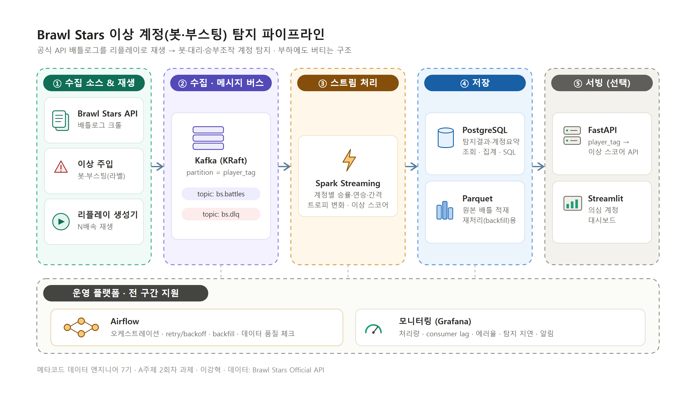

# Brawl Stars 이상 계정(봇·부스팅) 탐지 파이프라인

> 초안임. `TODO` 표시는 직접 돌려보며 확정할 값(샘플 크기·재생 속도 등).

## 한 줄 요약

브롤스타즈 공식 API로 실제 배틀로그를 모아 스트림처럼 재생하고, 봇·대리(트로피 부스팅)·승부조작 같은 이상 계정을 탐지하는 파이프라인.
탐지만이 목적이 아니라, 트래픽을 올려도 유실·중복 없이 버티는 구조가 진짜 목표임.

- 데이터 — 브롤스타즈 배틀로그(실데이터) + 가짜 이상 계정 소량 주입(정답 라벨).
- 문제 — "이 계정, 봇·대리·조작 아닌가?" 판단.
- 사용자 — 게임 운영/안티치트 담당자. 대시보드에서 "지금 의심 계정" 확인.

## 1. 사용 데이터

### 출처

브롤스타즈 공식 API 사용 (`developer.brawlstars.com`에서 무료 토큰 발급, `https://api.brawlstars.com/v1`).
핵심은 배틀로그 엔드포인트. 플레이어 태그당 최근 25전 반환. 한 판마다 시각·모드·맵·승패·트로피 변화·브롤러·팀 구성 포함.

- `GET /rankings/{country}/players` — 상위 랭커 태그 (수집 시작점)
- `GET /players/{tag}/battlelog` — 최근 배틀 기록
- `GET /players/{tag}` — 프로필(트로피·레벨)

수집 방식 — 랭킹에서 시작 태그 확보 → 각 태그 배틀로그 수집 → 배틀에 나온 상대 태그로 확장(크롤).

API에 rate limit 있음. 실시간으로 계속 당기면 6회차 부하 테스트 불가. 
따라서 배틀로그를 한 번 모아 JSON으로 저장 → 리플레이 생성기가 battleTime 순서로 배속 재생해 Kafka로 전송. 실데이터를 쓰되 속도는 직접 조절함.

### 이벤트 단위·스키마

이벤트 = 한 배틀 (로그 주인 계정 관점). 수 단위 스트림이 아니라 배틀 요약 단위라 다소 굵음. 대신 봇·부스팅은 배틀 패턴에서 더 잘 드러남.

```jsonc
// topic: bs.battles  (한 배틀 = 한 이벤트)
{
  "event_id":        "20260115T120000Z_#ABC",  // battleTime + player_tag, 중복 제거 기준
  "battle_id":       "a1b2c3",                  // battleTime + 참가자 태그 해시
  "player_tag":      "#ABC",
  "ts":              "2026-01-15T12:00:00Z",    // battleTime, 지연·순서 기준
  "mode":            "gemGrab",
  "map":             "Hard Rock Mine",
  "type":            "ranked",
  "result":          "victory",                 // victory / defeat / draw
  "duration_s":      117,
  "trophy_change":   8,                          // 이 판의 트로피 증감
  "is_star_player":  true,
  "brawler_id":      16000000,
  "brawler_name":    "SHELLY",
  "brawler_power":   11,
  "brawler_trophies":760,
  "opponents":       ["#DEF", "#GHI", "#JKL"],   // 승부조작 탐지용
  "is_injected":     0                           // 가짜 이상 계정이면 1
}
```

- ID — `event_id` 있음 (중복 제거·멱등 저장 기준)
- 발생 시각 — `ts`(battleTime) 있음 (지연 측정·윈도우 집계 기준)

### 규모 (숫자 두 개 → 용량)

- 건당 크기 ≈ 0.6 KB (opponents 배열 포함 JSON 기준)
- 수집 규모 — 플레이어 5,000명 × 25전 ≈ 12.5만 배틀 ≈ 약 75 MB (JSON) / Parquet 압축 시 ≈ 15 MB  *(TODO: 실제 수집 후 확정)*
- 매일 수집 지속 시 ≈ 75 MB/일 → 7일 보관 ≈ 약 525 MB (JSON) / Parquet ≈ 100 MB 내외
- 재생 속도 — 평상 TODO 300/s, 부하 테스트 TODO 3,000 → 30,000/s
- 부하 재생 대역폭 ≈ 30,000/s × 0.6 KB ≈ 18 MB/s (저장이 아니라 Kafka 통과량)

→ 저장 부담은 작음(수십~수백 MB). 관건은 저장 용량이 아니라 **부하 시 처리 대역폭**. 실시간 생성이 아니라 리플레이 기반이라 이렇게 해석함.

### 이상 정의 — 무엇을 "이상"으로 보나

- 봇/매크로 — 플레이 간격이 비정상적으로 규칙적, 같은 모드·같은 브롤러만 반복
- 트로피 부스팅(대리) — 짧은 기간 트로피 급등 + 승률 비정상
- 승부 조작(win-trading) — 특정 상대와 반복 대전하며 번갈아 승패, 트로피 교환
- 신규 계정 어뷰징 — 새 계정인데 고트로피 상대와만 매칭

공개 데이터에 "봇" 라벨 없음. 따라서 가짜 이상 계정 배틀을 소량 주입(`is_injected=1`)해 정답 확보 → 탐지 정확도(precision/recall) 평가 가능하게 만듦.

## 2. 전체 구조도



흐름 — 브롤스타즈 API에서 배틀로그 수집 + 가짜 이상 계정 혼합 → 리플레이 생성기로 재생(①) → Kafka 수신(②) → Spark가 계정별로 승률·연승·플레이 간격·트로피 변화 집계 후 이상 스코어 산정(③) → 결과는 PostgreSQL, 원본은 Parquet 저장(④) → FastAPI·Streamlit으로 노출(⑤). 전 구간을 Airflow가 오케스트레이션, Grafana로 모니터링.

- 수집→Kafka — JSON 이벤트, 배속 재생, `key=player_tag`
- Kafka→Spark — micro-batch(trigger 1분), 계정별 집계
- Spark→PG — 탐지 결과 upsert(player_tag 기준)
- Spark→Parquet — 원본 append, 날짜(dt=) 파티셔닝, 재처리용
- 전 구간→Grafana — 처리량·consumer lag·에러율·탐지 지연 관측 + 임계 초과 시 알림

## 3. 플랫폼 선정 이유 (ADR: 맥락·결정·대안·트레이드오프)

### Kafka
- 맥락 — 배틀 이벤트를 계정별 순서로 유지하며, 실시간 탐지와 원본 적재가 같은 스트림을 각자 소비해야 함. 부하 시 생산/소비 속도차 완충 필요.
- 결정 — Kafka (topic `bs.battles`, partition=`player_tag`, retention 7일).
- 대안 — 파일로 쌓아 배치 처리.
- 트레이드오프 — 운영 컴포넌트가 하나 늘고 로컬 리소스 사용 증가. 단순 파일보다 구조가 복잡해짐.

### Spark
- 맥락 — 이벤트 수십만~수백만 + 스트리밍 + 계정별 윈도우 집계 필요. 데이터 확장 대비.
- 결정 — Spark Structured Streaming.
- 대안 — Pandas 배치 처리.
- 트레이드오프 — 러닝커브·메모리 부담. 데이터가 적으면 오히려 Pandas가 더 간단·빠름.

### Airflow
- 맥락 — 수집(크롤) → 적재 → 일배치 집계 → 품질 체크가 의존 관계. 재시도·backfill·실행 상태 UI 필요.
- 결정 — Airflow (`@daily` DAG, retry + exponential backoff).
- 대안 — cron.
- 트레이드오프 — 셋업이 무겁고 메타DB 필요. 단순 반복이면 cron이 더 가벼움.

### 저장소 이중화 (PostgreSQL + Parquet)
- 맥락 — 탐지 결과는 자주 조회(대시보드·API), 원본은 대량 보관 + 재처리(backfill) 필요.
- 결정 — 결과는 PostgreSQL, 원본은 Parquet.
- 대안 — 한쪽만 사용.
- 트레이드오프 — 저장 로직 두 벌 관리. 결과·원본 간 일관성 신경 써야 함.

### 모니터링 (Grafana)
- 맥락 — 부하 시 처리량·consumer lag·에러율·탐지 지연을 한눈에 보고, 기준 초과 시 알림 필요(6회차 로드 테스트 핵심 지표).
- 결정 — Grafana 대시보드 + 알림. 데이터 소스는 PostgreSQL(탐지·집계 지표) + Prometheus(Kafka/Spark 시스템 지표).
- 대안 — 로그만 보기, 또는 Streamlit에 모니터링까지 몰기.
- 트레이드오프 — 모니터링 컴포넌트가 하나 늘어남. 다만 시스템 관측은 Grafana가 표준이라, 결과 조회(Streamlit)와 시스템 모니터링(Grafana)을 분리하는 게 깔끔함.

## 4. 레포 구조 (최종 산출물까지)

```
brawlstars-anomaly-pipeline/
├─ fetch_battlelogs.py  # 브롤스타즈 API 크롤 → 배틀로그 JSON 저장
├─ producer.py   # 배틀로그를 battle 이벤트로 재생해 Kafka로, 속도 조절
├─ anomaly_injector.py  # 가짜 이상 계정(봇·부스팅) 배틀 주입 (라벨)
├─ consumer.py          # Kafka 수신 → 원본 Parquet 적재
├─ preprocess.py        # Spark 전처리·계정별 집계·이상 스코어
├─ dag.py               # Airflow DAG (수집~집계·품질체크)
├─ schema.sql           # PostgreSQL 저장 스키마
├─ create_topics.sh     # Kafka 토픽(bs.battles·bs.dlq) 생성
├─ make_sample.py       # 토큰 없이 테스트용 가짜 배틀로그 생성
├─ docker-compose.yml   # Kafka(KRaft)·Spark·Airflow·PostgreSQL·Grafana
├─ api/                 # (선택) FastAPI 서빙 + Streamlit 대시보드
└─ README.md
```

## 5. Kafka 수집

### Producer 흐름

```
읽기(배틀로그 JSON) → 공통 껍데기로 감싸 직렬화(JSON bytes) → 전송(send) → 콜백으로 성공/실패 확인
```

`producer.py`가 담당. 안정성 설정은 `acks=all`(모든 복제본 확인), `enable_idempotence=true`(재시도해도 중복 저장 안 됨), `compression.type=lz4`(압축). 전송 결과는 **콜백**으로 확인해 실패를 놓치지 않음.

### 메시지 예시 (공통 껍데기 + payload)

```jsonc
key = "#ABC"                       // player_tag → 같은 계정 순서 보장
{
  "event_id":       "20260115T120000Z_#ABC",  // 중복 제거·멱등 저장 기준
  "event_type":     "battle",                  // 이벤트 종류
  "event_time":     "2026-01-15T12:00:00Z",    // 발생 시각
  "schema_version": 1,                         // 필드 바뀌어도 consumer 안 깨짐
  "source":         "replay-generator",        // 출처
  "payload": {                                 // 종류별 실제 데이터
    "battle_id": "a1b2c3", "player_tag": "#ABC",
    "mode": "gemGrab", "result": "victory", "trophy_change": 8,
    "brawler_name": "SHELLY",
    "teammates": ["#DEF"],                     // 같은 팀(나 제외) → 팀 어뷰징 탐지
    "opponents": ["#GHI", "#JKL"],             // 상대 팀만 → 승부조작 탐지
    "is_injected": 0
  }
}
```

> **피드백 반영 — 팀원/상대 분리**: 기존엔 `opponents`를 "나를 뺀 전원"으로 잡아서 **팀원이 상대에 섞였음**. 배틀 데이터의 `teams`(팀 2개 리스트)에서 **내가 속한 팀 → `teammates`, 나머지 팀 → `opponents`**로 분리하도록 수정함. 이렇게 해야 **승부조작**(상대 반복)과 **팀 어뷰징/듀오 부스팅**(팀원 반복)을 각각 정확히 탐지할 수 있음.

### Topic 구성

| 항목 | 값 | 이유 |
|---|---|---|
| 토픽명 | `bs.battles` | 배틀 이벤트 전용 (실패 메시지는 `bs.dlq`로 분리) |
| 파티션 | 3 | 병렬 처리 상한. 로컬 3개로 시작 → 6회차에 늘려가며 처리량 측정 |
| key | `player_tag` | 같은 계정 이벤트의 순서 보장 (승률·연승 계산에 필요) |
| 리텐션 | 7일 | 재처리 가능 기간. 앞의 용량 계산과 함께 결정 |

### 실행

```bash
docker compose up -d kafka            # Kafka 기동
bash create_topics.sh                 # 토픽 생성
python producer.py --in data/raw --rate 300   # 전송 (초당 300건)
```

## 6. 트러블슈팅 기록 (수집 구현 중 겪은 이슈)

에러 메시지(근거)로 원인을 좁혀 해결한 기록. 모두 실제로 겪은 사례.

| 증상 | 확인한 근거 | 원인 | 해결 / 다음 행동 |
|---|---|---|---|
| `OCI runtime exec failed: .../Git/opt/kafka/...` | 에러 속 경로가 Git 설치폴더로 바뀜 | Git Bash(MSYS)가 `/opt/...`를 Windows 경로로 자동 변환 | `MSYS_NO_PATHCONV=1` 적용 (create_topics.sh에 내장) |
| 전송/수신 로그 한글 `▒▒▒` | 콘솔 출력만 깨짐(데이터는 정상) | 콘솔 인코딩(cp949) | `PYTHONUTF8=1 python ...` 로 실행 |
| `python producer.py` → `No such file` | 에러 메시지 | 상위 폴더에서 실행(파일은 `projects/...` 하위) | 프로젝트 폴더로 `cd` 후 실행 |
| `docker compose up` → `no configuration file provided` | 에러 메시지 | compose 파일 없는 폴더에서 실행 | 프로젝트 폴더에서 실행 |
| `git push` → `rejected (fetch first)` | push 거부 메시지 | 원격에 먼저 올라간 커밋 존재 | `git fetch` + `git rebase` 후 push |
| `bash` 실행 실패 (`execvpe /bin/bash`) | 에러 메시지 | PowerShell의 `bash`가 미설정 WSL로 연결 | **Git Bash**에서 실행 |
| (API) `403 Forbidden` | 응답 코드 | 토큰 등록 IP와 현재 IP 불일치 | developer 포털에서 현재 IP로 키 재발급 |

> 핵심: 증상이 나오면 **에러 메시지를 근거로 원인을 하나씩 좁혀** 해결함. 환경(Windows/Git Bash) 이슈가 대부분이었고 파이프라인 로직 문제는 아니었음.

## 7. 재시작과 멱등성 (멈춰도 안전하게)

### 멱등성 2종 — 구분이 핵심
| 종류 | 무엇을 막나 | 우리 구현 |
|---|---|---|
| **전송 멱등** (`enable_idempotence`) | **재시도** 중 생기는 중복만 | ✅ producer 설정 |
| **저장 멱등** (`event_id` 유일 + upsert) | **프로그램 재실행**으로 생기는 중복 | ✅ event_id 고정 + 저장단계 upsert |

→ 전송 멱등만으로는 **재실행 중복을 못 막음**. 최종 중복 제거는 **저장 멱등(event_id)**이 담당.

### 중간에 멈추면 어떻게 되나
- **수집(fetch)·전송(producer)**: 진행 위치를 기록하지 않음 → **처음부터 전체 재전송**
- 이미 보낸 게 또 와도 `event_id = battleTime + player_tag`가 **재실행해도 동일** → 저장 시 **같은 id면 덮어씀(upsert)** → 중복 제거
- 결과: **유실 없음**(전체 재전송) + **중복은 흡수** → "재처리 + 멱등" 방식
- **소비(consumer/Spark)**: Kafka가 **offset을 기록** → 멈춘 지점부터 자동 재개 (`checkpointLocation`)

### 트레이드오프
재실행 시 전체 재처리라 비효율은 있으나 **소량 리플레이라 무시 가능**. 단순함을 위해 체크포인트(진행위치 기록) 대신 **재처리+멱등**을 택함. 데이터가 커지면 fetch에 진행위치 저장을 추가할 수 있음.

### 커밋 순서 원칙
`처리 → 저장 → (진행위치) commit` 순서. commit을 **먼저** 하면 저장 실패 시 **유실**, **나중에** 하면 중복(멱등으로 해결). 그래서 **commit은 항상 마지막 + 멱등 저장**. (consumer는 `enable_auto_commit=False`)

## 8. 전처리와 저장 (4회차) — `preprocess.py`

### 처리 흐름

```
Kafka(bs.battles) ──배치 읽기──▶ 전처리 ──▶ Parquet(정제 원본)
                                    │
                                    └─집계·이상 스코어─▶ PostgreSQL(탐지 결과)
```

입력은 **Kafka(`bs.battles`)에서 읽는다** — 파일을 직접 읽으면 Kafka를 쓰는 의미가 없으므로, 수집 구간이 넣어둔 Kafka 데이터를 Spark가 소비한다. (Spark의 `read.format("kafka")`로 `earliest~latest` 전체를 **배치**로 읽음)

### 전처리 단계 (자료 기준)

| 항목 | 처리 | 코드 |
|---|---|---|
| 자료형 | `event_time` 문자열 → timestamp(UTC, **발생 시각**) | `to_timestamp` |
| 결측 | 필수 필드(`event_id`·`player_tag`·`event_time`) 없으면 제거 | `dropna` |
| 중복 | **`event_id` 기준** 중복 제거 (재실행 중복 흡수) | `dropDuplicates(["event_id"])` |
| 집계 | 계정별 승률·트로피 증감·브롤러 다양성 | `groupBy("player_tag")` |

### 입력 · 출력 예시

입력 (Kafka 메시지, 공통 껍데기) — §5 참고.
출력 (계정별 탐지 결과, `detection_result`):

```
[입력] Kafka 메시지 125건  →  [정제] 118건 (중복·결측 제거 후)   ← 실행 시 실제 숫자
player_tag   | battles | win_rate | brawler_variety | anomaly_score | anomaly_reason | is_injected
#8LQCUYPYL   |   25    |  1.00    |       1         |     0.8       |   boosting     |    0
#2PP0...     |   22    |  0.95    |       1         |     0.6       |   bot          |    1
#XYZ...      |   18    |  0.50    |       6         |     0.1       |   normal       |    0
```

### 최종 스키마 — `detection_result` (PostgreSQL)

| 필드 | 타입 | 의미 |
|---|---|---|
| `player_tag` | TEXT (PK) | 계정 (고유 키) |
| `battles` | INT | 집계 대상 배틀 수 |
| `win_rate` | DOUBLE | 승률 (0~1) |
| `trophy_gain` | INT | 누적 트로피 증감 |
| `brawler_variety` | INT | 브롤러 종류 수 (1이면 봇 의심) |
| `anomaly_score` | DOUBLE | 이상 점수 (0~1) |
| `anomaly_reason` | TEXT | bot / boosting / normal |
| `is_injected` | SMALLINT | 평가용 정답 라벨 |
| `updated_at` | TIMESTAMPTZ | 갱신 시각 |

고유 키 = `player_tag`. 정제 이벤트의 중복 판단 기준 = `event_id`(= battleTime+player_tag).

### 저장 포맷과 이유

| 저장소 | 포맷 | 이유 |
|---|---|---|
| PostgreSQL | 테이블 | 탐지 **결과를 빠르게 조회**(대시보드·API). SQL·인덱스·집계 |
| Parquet | 컬럼 기반 파일 | **정제 원본 보관 + 재처리**. 압축·분석 최적화. 날짜(`dt=`) 파티셔닝 |

재실행하면 Kafka 전체를 다시 읽어 결과를 **덮어씀(overwrite)** → 멱등(같은 입력이면 같은 결과).

### 실행 (Spark 컨테이너 안에서 — 로컬 Java/pyspark 불필요)

```bash
docker compose up -d kafka postgres spark
bash create_topics.sh
PYTHONUTF8=1 python producer.py --in data/raw --rate 10     # Kafka에 데이터 채우기
docker compose exec spark spark-submit --master "local[*]" \
  --packages org.apache.spark:spark-sql-kafka-0-10_2.12:3.5.1,org.postgresql:postgresql:42.7.3 \
  /app/preprocess.py
```

> Spark가 **Kafka 컨테이너에 접속하려면** 내부 리스너가 필요해서 docker-compose의 Kafka에 `kafka:29092`(컨테이너용) + `localhost:9092`(호스트용) **2개 리스너**를 설정함. (3회차 자료의 listener 이슈 대응)
